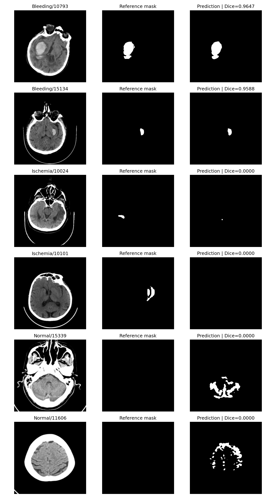

# E1 数据质量实验结果（乔震宇）

## 目的与设置

比较基础红色掩码与红蓝并集掩码。保持简单 2D U-Net、256×256 灰度输入、Dice+BCE、无增强、种子 42、阈值 0.5 及冻结病例集合不变。未删除样本，未修改外部官方掩码或标签。

指标来源：用户于 2026-11-01 从 Kaggle 统一评估入口复制的完整 JSON，已保存为本目录 metrics.json。基线来源：../baseline/metrics.json。训练完成截图记录为 8 轮后早停，最佳模型第 4 轮；完整训练日志、曲线、环境、逐病例结果及最佳权重已下载归档；Kaggle 已加载最佳权重生成 samples.png。

## 历史记录对照（内部参考掩码不同）

| 指标 | 历史基线 | E1 | 差值 E1−基线 |
| --- | ---: | ---: | ---: |
| 内部阳性 Dice | 0.301559 | 0.316028 | +0.014469 |
| 内部阳性 IoU | 0.240271 | 0.257837 | +0.017567 |
| 内部像素 Precision | 0.523484 | 0.629222 | +0.105738 |
| 内部像素 Recall | 0.223865 | 0.211295 | -0.012570 |
| Normal 假阳性像素比例 | 0.002109 | 0.001844 | -0.000265 |
| Bleeding Dice | 0.612493 | 0.642661 | +0.030168 |
| Ischemia Dice | 0.001599 | 0.000922 | -0.000677 |
| 外部阳性非空掩码 Dice | 0.403150 | 0.426670 | +0.023519 |
| 外部图像检出 F1 | 0.547170 | 0.542714 | -0.004456 |
| 外部图像检出 Recall | 0.828571 | 0.771429 | -0.057143 |

## 结论与是否建议采用

内部阳性 Dice 的记录值增加约 0.01447，未达到分工方案中约 0.02 的参考目标；内部 Recall 下降约 0.01257。Normal 假阳性像素比例下降约 12.55%。Bleeding Dice 为 0.64266，但 Ischemia Dice 仅 0.000922，低于历史记录 0.001599，缺血分割未得到有效改善。外部非空阳性掩码 Dice 增加约 0.02352，图像级 F1 从 0.54717 降至 0.54271，图像级 Recall 从 0.82857 降至 0.77143。
当前证据不足以证明 E1 为净改进，不建议直接纳入最终组合。保留为已完成的数据质量对照实验，并说明负面结果；不因本次外部测试指标而继续调参。

## 评估解释与限制

- E1 配置同时影响训练和内部评估的 mask_mode。因此内部 Dice/IoU 的历史差值不是同一标注标准下的纯模型改进。应使用统一参考掩码对基线权重与 E1 权重重新评估；当前不修改共用评估脚本。
- 代码审计确认冻结病例集合未改动。历史基线 JSON 仍保留 provisional=true 和旧切分版本名；这是历史记录，不覆盖它，正式报告需说明其与冻结切分的成员关系。
- 外部卒中标签阳性共 70 张，其中 7 张掩码为空。分割阳性平均基于非空掩码的 63 张，图像检出基于标签的 70 张，二者分母不同。
- 外部 overall_segmentation.normal_case_count=0 是按 group=Normal 汇总的实现结果，不能解释为外部没有阴性病例，也不能用其 0.0 假阳性像素比例声称外部无假阳性。外部检出实际 FP=75、TN=55。
- 审计发现跨划分完全重复灰度图像 10 组，包含训练与外部测试重复；所有当前指标均应披露该限制，不能宣称独立无泄漏泛化。需改变病例集合时应新建切分并重跑基线，不能私改 baseline-v1。
- environment.json 确认当前 PyTorch 为 2.11.0+cu128；与基线的软件版本一致性待核验，不能声称运行环境完全相同。
- 红蓝并集训练集样例的新增像素主要沿标记边缘；预测样例已归档为 samples.png，选取依据见 selected_samples.csv。

## 数据审计

完整结果见 audit/。248 张主数据与 8 张外部图像尺寸不是 512×512；原图与掩码尺寸不一致数量为 0；现有读取代码同步缩放图像和掩码。7 个外部标签/空掩码冲突保留原样记录。

## 待归档与提交

- 已归档 run.log、curves.png、train_summary.json、environment.json、test_per_case.csv、external_test_per_case.csv 和 best.pt。inference_summary.json 尚未归档；检出指标已在 metrics.json 中。
- 最佳权重 best.pt 已单独保存并由 Git 忽略；samples.png 已归档，绘图入口为 scripts/e1_samples.py。
- 与基线负责人核对统一参考掩码下的评估，并同步重复图像审计结果。
- 按团队流程关联 Issue，提交 feat/data-quality 的 PR，由负责人评审；当前未创建 Issue、提交、推送或合并。

## 本地归档核验

artifact_manifest.json 记录模型及主要结果文件的 SHA256。内部逐病例记录 998 行，外部 200 行；重算 Bleeding/Ischemia 平均 Dice 与 metrics.json 一致。冻结切分校验和与云端环境记录一致。selected_samples.csv 是用于展示的极端案例，不能用于估计总体性能，也不据此调参。

## 成功与失败样例

Bleeding/10793 与 Bleeding/15134 的 Dice 分别为 0.9647 和 0.9588，预测与参考掩码高度重合。Ischemia/10024 的预测没有覆盖参考病灶（Dice=0），Ischemia/10101 的预测为空（Dice=0）。Normal/15339 与 Normal/11606 的参考掩码为空但产生假阳性，逐病例预测像素数分别为 2773 和 2332。这些是按组内极端指标选择的展示病例，不代表平均性能，也不据此调参。

复现：`python scripts/e1_samples.py --config configs/experiments/E1_data_quality.yaml`（需要 PyTorch 和本地 best.pt；Kaggle 可设置 BSC_DATA_ROOT 指向挂载数据）。
